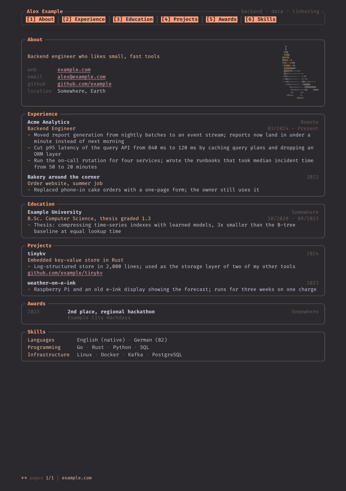

# ratatui-style CV

A [Typst](https://typst.app) CV that looks like a terminal app built with
[ratatui](https://ratatui.rs): bordered blocks with their titles in the border, a
numbered tab bar on every page (tabs for the panes on the current page are
highlighted), a status line at the bottom, and Fira Code throughout. The default
color scheme is ferra.



## Use

```sh
cp example.typ cv.typ   # cv.typ is gitignored, so your details stay local
typst compile cv.typ
```

You need Fira Code installed, or point Typst at it with `--font-path`. With Nix:

```sh
nix shell nixpkgs#typst nixpkgs#fira-code -c sh -c \
  'typst compile --font-path "$(dirname $(fc-match -f %{file} "Fira Code"))" cv.typ'
```

## Options

```typ
#show: cv.with(
  name: "Alex Example",            // left in the tab bar's border
  tagline: "backend · data",       // right in the tab bar's border
  headline: "One line about you",  // top of the About pane
  contacts: (("email", "alex@example.com", "mailto:alex@example.com"),),
  site: "https://example.com",     // status line link
  photo: image("assets/me.png"),   // leave out for the ascii bird
  theme: "gruvbox",                // ferra (default), paper, gruvbox, catppuccin, nord
  border: "plain",                 // rounded (default), plain, thick
  hashtags: true,                  // show each entry's `tags:` as #hashtags
  font: "JetBrains Mono",          // any monospace font
)
```

Everything except `name` is optional. `paper` is ferra on white, for printing.

### Your own colors

`theme` also takes a dictionary. Keys you leave out come from ferra, and you can
start from any built-in scheme instead:

```typ
theme: (accent: rgb("#7aa2f7"), label: rgb("#bb9af7")),
theme: themes.nord + (accent: rgb("#bf616a")),
```

| key      | used for                                          |
| -------- | ------------------------------------------------- |
| `bg`     | page background                                   |
| `fg`     | body text                                         |
| `muted`  | dates, locations, separators                      |
| `border` | pane borders                                      |
| `subtle` | tab bar and photo borders                         |
| `accent` | pane titles, name, active tab, list markers       |
| `label`  | entry titles, skill labels, headline              |
| `link`   | links                                             |
| `tag`    | hashtags                                          |
| `code`   | raw text                                          |

## Building blocks

- `section(title, tab: none)[...]`: a pane. `tab` gives a shorter name for the tab bar.
  If a pane breaks across pages, its title is repeated on the next page.
- `entry(society:, title:, location:, date:, description:, tags:, links:)`: one item.
  Every field is optional; leave out the ones that would only be filler.
- `honor(date:, title:, issuer:, location:)`: one line in an awards list.
- `skills(("Label", ("a", "b")), ...)`: label/value rows.

`entry` and `honor` take the same arguments as `cv-entry` and `cv-honor` in
[brilliant-cv](https://github.com/yunanwg/brilliant-cv), so entries from there paste in
with only the function name changed.

## License

MIT, see [LICENSE](LICENSE).
